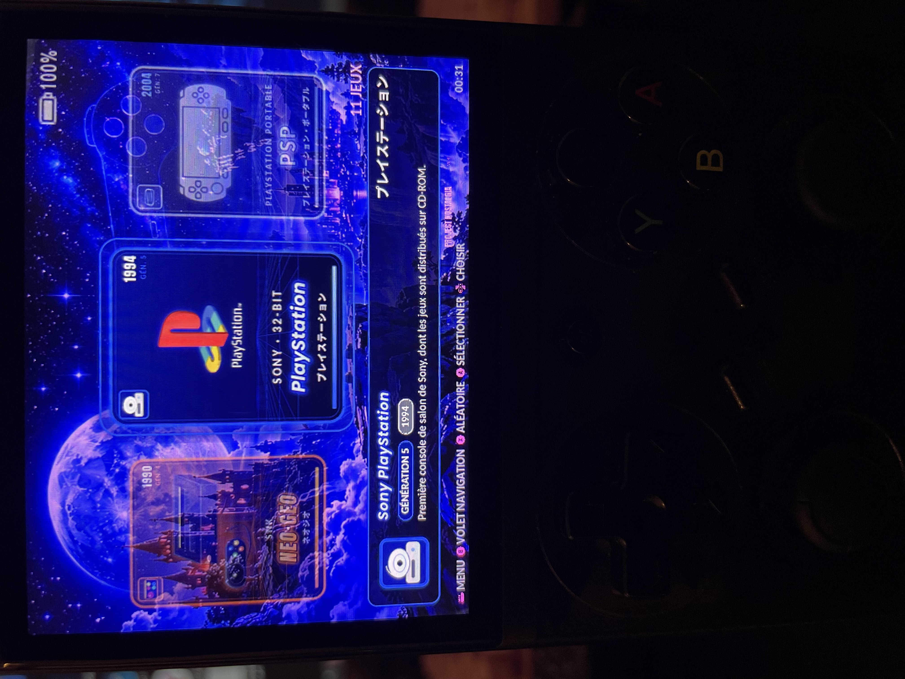
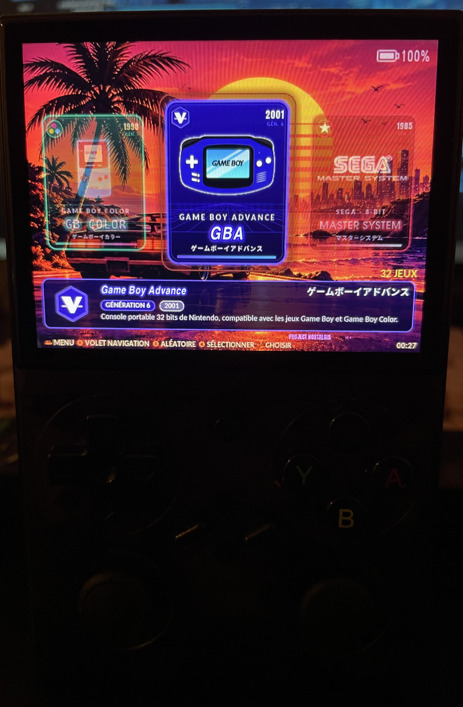
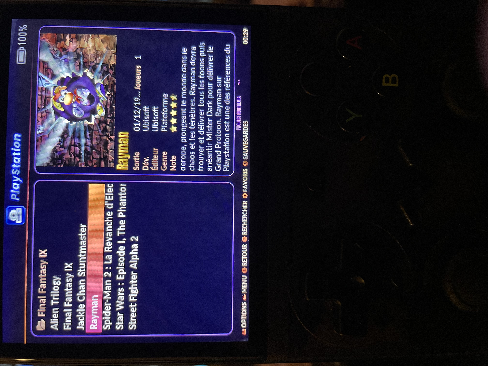

PROJECT NOSTALGIA

🎮 A premium retro-inspired EmulationStation theme designed for handheld gaming.

Inspired by the atmosphere of 90s Japanese arcades, Project Nostalgia brings the golden age of retro gaming to modern handheld devices through a distinctive visual identity.

🏙️ Inspired by the atmosphere of 90s Japanese arcades

💜 Dark Premium interface with neon aesthetics

🕹️ Redesigned system carousel featuring custom illustrations

📺 Optimized for 640×480 (4:3) handheld displays

⸻

## 📸 Screenshots

### 🎮 PlayStation – System Carousel

### 🎮 Game Boy Advance – System Carousel

### 🕹️ Rayman – Game List

⸻

📦 Latest Release & Compatibility

Project Nostalgia v0.6.1

Get the latest version, including the multi-firmware package, from the GitHub releases page.

⬇️ Download Project Nostalgia

The multi-firmware package includes dedicated configuration files for different EmulationStation-based firmware distributions.

Firmware	Configuration file	Status
KNULLI	theme.xml	Tested
Pan4Elec	theme.xml	Tested
dArkOS	theme.xml	Community tested
dArkOS4Clone	theme.xml	Community tested
ROCKNIX	theme.xml.rocknix	Community tested

Firmware-specific notes

* KNULLI / Pan4Elec: Use the default theme.xml. No changes required.
* dArkOS / dArkOS4Clone: The default configuration supports color schemes and UI scaling. theme.xml.darkos is available as a fallback if something doesn’t display correctly.
* ROCKNIX: Use theme.xml.rocknix. Compatibility has been tested and confirmed by the community on Discord.

⸻

Installation

Copy the PROJECT-NOSTALGIA folder into your firmware’s themes folder, then select it in EmulationStation (Start → UI Settings → Theme).

Knulli / Pan4Elec: nothing to change, theme.xml is the default version.

ROCKNIX: delete theme.xml, then rename theme.xml.rocknix to theme.xml. The content is the same as the Knulli version.

dArkOS / dArkOS4clone: delete theme.xml, then rename theme.xml.darkos or theme.xml.darkos4clone to theme.xml.

Language: automatic on Knulli, Pan4Elec and ROCKNIX. On dArkOS, set infoLang at the top of theme.xml (en, fr, es, pt, ru, de, it).

⸻

🌍 Supported Languages

Project Nostalgia supports seven languages:

* English
* French
* Spanish
* Portuguese
* Russian
* German
* Italian

Language selection is automatic on KNULLI, Pan4Elec and ROCKNIX. On dArkOS, the language can be configured manually through the infoLang setting.

⸻

✨ Features

* Custom System Carousel – A redesigned carousel with distinctive illustrations for each gaming platform.
* 135+ Supported Systems – Extensive coverage of classic gaming systems and platforms.
* Custom System Illustrations – Dedicated artwork created to give each system its own visual identity.
* Retro-Inspired Visual Design – Atmospheric backgrounds, arcade-inspired elements and neon accents.
* Dark Premium Interface – A consistent visual experience designed for comfortable navigation.
* Detailed System Information – Clear and accessible information while browsing your collection.
* Dedicated Game Views – Custom layouts for game lists and individual game information.
* Single Navigation Sound Configuration – A unified configuration for navigation audio.

⸻

🎮 Project Philosophy

Project Nostalgia is built around a simple idea:

Bringing the atmosphere of classic gaming into a modern handheld experience.

Inspired by the golden age of Japanese arcades, the project combines nostalgic visual elements with a clean, readable and immersive interface.

From the system carousel to the game browsing experience, every detail contributes to recreating the feeling of stepping into a classic arcade.

The goal is not simply to display a game collection, but to make browsing it part of the experience.

⸻

❤️ Community & Feedback

Project Nostalgia is an ongoing community-driven project.

Feedback, suggestions, bug reports and compatibility testing are always welcome.

A special thanks to everyone in the Discord community who helped test the theme across different firmware distributions.

Community feedback plays an important role in improving compatibility, refining the visual experience and making each release better.

Thank you for being part of the project!

Enjoy the nostalgia! 🕹️
